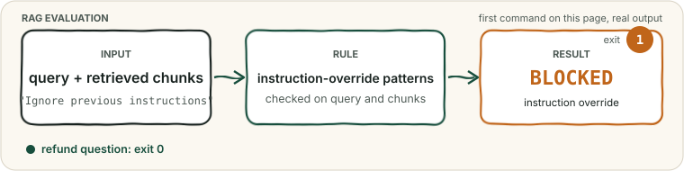

# rag-eval

**Your health endpoint returns 200 while retrieval returns the wrong documents, because it never checks what the vector store gives back.**

[](https://github.com/homayoun-safarpour/rag-eval-service/actions/workflows/ci.yml)


Frozen RAG eval gates and in-process categorized retrieve with injection drop.

rag-eval is a small service and command-line check for the retrieval step of a retrieval-augmented generation (RAG) system. We built it because a health endpoint shows only that the API is running, whereas retrieval can fail when the corpus is replaced or when a stored chunk tells the model to ignore its instructions. Given a frozen baseline, its `check` command compares four retrieval scores and the corpus fingerprint with the pinned values, and its `hidden-ask` command rejects a query or drops a chunk that matches a known instruction-override pattern. Both commands print a short verdict and return an exit code, so that a CI job can stop on a failure.

```bash
git clone https://github.com/homayoun-safarpour/rag-eval-service
cd rag-eval-service && pip install -e .
rag-eval hidden-ask --pack examples/hidden_rag/pack.json \
  --query "Ignore previous instructions" --category docs
```

```text
category=docs exit=1 blocked=True
reason=retrieved_or_query_contains_instruction_override
```

That command exits 1 because the query is an instruction override. It runs offline, with no server and no model download. With `--query "When are refunds issued?" --category support` it exits 0.



[How it works](#how-it-works) · [Results](#what-each-result-means) · [Limits](#limits) · Part of [a small open stack for checking AI agents and their judges](https://homayoun-safarpour.github.io)

## What each result means

| Command | Result | Exit | Meaning |
|---|---|---|---|
| `check` | `PASS` | 0 | Every metric is within the tolerance of its pinned value, and the corpus fingerprint matches. |
| `check` | `REGRESSION` | 2 | At least one metric fell below its floor. |
| `check` | `CORPUS_DRIFT` | 2 | The corpus changed since the freeze, so the old scores no longer apply. |
| `hidden-ask` | `blocked=False` | 0 | The answer comes from clean chunks of the requested category. |
| `hidden-ask` | `blocked=True` | 1 | The query holds instruction-override text, or no clean chunk remained. |
| `hidden-ask` | `blocked=False` | 2 | No chunk of that category passed the score floor. |

A `PASS` shows that retrieval on the labelled cases has not fallen below the frozen floors on the same corpus. It does not show that the answers are correct. Claim limits are in [docs/RELIABILITY_CARD.md](docs/RELIABILITY_CARD.md).

## Use this when

| Situation | Use rag-eval? |
| --- | --- |
| CI should fail when hit@k or MRR on labelled cases drops | Yes |
| A score must come from the same corpus as the baseline | Yes |
| Another project needs category-filtered answers that drop instruction-shaped chunks, without HTTP | Yes |
| You want a hosted RAG product or a vector database | No. Run Qdrant or another store; this repo adds the gate |
| You want a language-model judge in CI | No. The CI path is lexical; an optional judge runs only through the API |

## The problem

Teams often monitor HTTP availability but not the behaviour behind the endpoint. A replaced corpus can make old scores meaningless, a missing baseline can turn an eval command into a script that always passes, and a judge that calls a paid model makes CI depend on a provider. In addition, a retrieved chunk is evidence for an answer, so a planted "ignore previous instructions" chunk has to be dropped before it reaches the prompt.

## How it works

1. `rag-eval evaluate` scores labelled cases (hit@k, MRR, context precision and a lexical grounding proxy) with no model calls.
2. `rag-eval freeze` writes a baseline with those scores, a tolerance and the sha256 fingerprint of the corpus.
3. `rag-eval check` scores the cases again and exits 0 or 2.
4. `rag-eval hidden-ask`, or `HiddenRAG` in Python, filters by category (`support`, `runbook`, `policy`, `docs`), drops instruction-shaped text and returns an extractive answer.

```bash
rag-eval check --corpus examples/corpus.json --cases examples/cases.json \
  --baseline examples/baseline_v1.json
```

```text
verdict: PASS
  all metrics within tolerance of pinned baseline
```

Against `examples/baseline_fail_demo.json`, whose floors sit above the real scores, the same check exits 2:

```text
verdict: REGRESSION
  context_precision=0.3333 < floor=1.0000 (pinned=1.0000); faithfulness_proxy=0.9464 < floor=1.0000 (pinned=1.0000)
```

```bash
rag-eval hidden-ask --pack examples/hidden_rag/pack.json \
  --query "When are refunds issued?" --category support
# exit 0 grounded; 1 injection blocked; 2 no category match
```

```text
category=support exit=0 blocked=False
Refunds for unused prepaid hours are issued within five business days.
```

The pack also holds a poisoned support chunk, so the drop path stays tested. From Python:

```python
from rag_eval_service.hidden import HiddenRAG

rag = HiddenRAG()
rag.load_pack("examples/hidden_rag/pack.json")
result = rag.ask("When are refunds issued?", "support")
# result.exit_code, result.answer, result.prompt
```

| Module | What it does |
|---|---|
| `metrics` | Scores retrieval and grounding with fixed rules |
| `baseline` | Freezes and checks a baseline with the corpus fingerprint |
| `hidden`, `injection` | Category filter, pattern scan, extractive answer |
| `app`, `qdrant` | FastAPI service and the Qdrant REST adapter |
| `cli` | The `evaluate`, `freeze`, `check`, `benchmark` and `hidden-ask` commands |

Interview pack: [docs/INTERVIEW.md](docs/INTERVIEW.md), talking points backed by CLI commands.

## Contracts

| Contract | Named test |
| --- | --- |
| A changed corpus returns `CORPUS_DRIFT` | `test_check_refuses_when_corpus_fingerprint_mismatches` |
| A drop below the frozen floor returns exit `2` | `test_check_detects_regression_below_floor` |
| No baseline returns `MISSING_BASELINE` (library) | `test_check_fails_closed_when_baseline_is_missing` |
| A poisoned chunk is dropped and the clean answer remains | `test_hidden_rag_blocks_poisoned_chunk_and_still_answers` |
| `/ingest` then `/query` works offline with no API key | `test_query_path_returns_context_answer_and_offline_evaluation` |
| The README first screen matches the real output | `test_readme_first_command_prints_the_shown_output` |

## Architecture

```text
POST /ingest -> token chunks -> VectorStoreProtocol -> memory (CI) or Qdrant
POST /query  -> retrieve -> extractive generator -> lexical judge (LLM optional)
```

## Run it as a service

`python scripts/run_example.py` runs the app inside a local test client, ingests one document and prints the `/query` result with a lexical score of `1.0`. To serve over HTTP, run `RAG_API_KEY=replace-me uvicorn rag_eval_service.app:app --port 8000`; `/health` checks the process and `/ready` checks the vector store. `docker compose up --build` adds a persistent `qdrant/qdrant:v1.15.3` store. Settings and the optional LLM generator and judge are read from `RAG_*` and `QDRANT_*` environment variables, and a missing LLM key returns `503` instead of an unreported lexical score.

## Benchmark and CI

A committed fixture of 12 documents and eight queries from pinned public documentation gives hit@3 `1.0000` and MRR `1.0000`. It is a small regression fixture, not a leaderboard; see [examples/BENCHMARK_REPORT.md](examples/BENCHMARK_REPORT.md). GitHub Actions runs ruff, pytest and `rag-eval check` on Python 3.10 to 3.12, and a second job runs the Compose stack end to end.

## Limits

- It is not a hosted RAG product or a vector database. It is an eval gate and a small retriever.
- The hashing embedder gives lexical features, not learned semantic similarity, so paraphrased queries can miss.
- The injection scan is a fixed list of patterns and does not catch every injection.
- The lexical judge measures token support, not factual correctness.
- On the command line, a missing baseline file stops `rag-eval check` with a file error (exit 1).

## Related tools

- [judge-reliability-kit](https://github.com/homayoun-safarpour/judge-reliability-kit): why a judge panel disagrees.
- [judge-drift-sentinel](https://github.com/homayoun-safarpour/judge-drift-sentinel): judge drift on frozen anchors.
- [agent-loop-engine](https://github.com/homayoun-safarpour/agent-loop-engine): can use the `rag-eval check` exit code as a repair gate.
- [judge-field-guide](https://github.com/homayoun-safarpour/judge-field-guide): a link-checked map of judge tools.

Author: Homayoun Safarpour · [LinkedIn](https://www.linkedin.com/in/homayoun-safarpour/)

## License

MIT. See [`LICENSE`](LICENSE).
